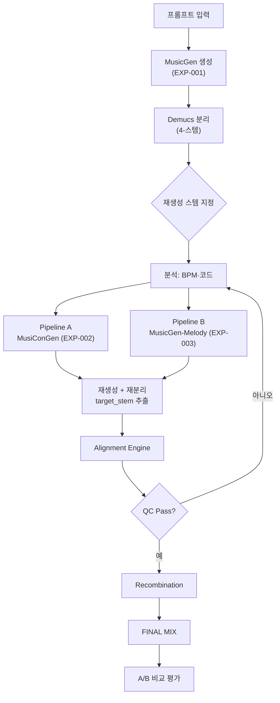

# Stem Remix Assistant

생성형 음악 모델로 만든 트랙에서 특정 스템만 재생성해 교체할 때 전체를 처음부터 재작업하지 않도록 구성한 파이프라인.

텍스트 프롬프트로 전체 트랙을 생성하고(MusicGen) 스템 단위로 분리한 뒤(Demucs) 원하는 스템만 재생성해 교체하는 생성 → 분리 → 재생성 루프를 Colab 무료 T4 환경에서 구현.

배경과 기술적 한계 검증 및 전체 시스템 설계는 [`docs/PROPOSAL.md`](docs/PROPOSAL.md) 에 정리.

환경 세팅은 [`docs/ENVIRONMENT_SETUP.md`](docs/ENVIRONMENT_SETUP.md) 참고.

### 현재 상태

| 구분 | 내용 |
|---|---|
| 동작 범위 | 원본 분석(스템 분리 · 코드 인식 · BPM)에서 조건부 재생성까지 |
| 당면 과제 | 재생성 음질이 코드 진행 일치도 측정 가능 수준에 미달 |
| 진행 단계 | 음질 저하 원인을 정량 지표로 분해하는 중 |
| 확보 성과 | 원인을 3개 층으로 분리하고 코드 결함 기여분 제거 완료 (→ [4. 주요 결과](#4-주요-결과)) |

## 1. 파이프라인

스템 단위 조건부 생성을 지원하는 모델은 아직 연구 단계에만 존재하며 비공개이거나 미배포 상태.

MusicGen 계열은 구조적으로 전체 믹스만 출력하므로 재생성 대상 스템마다 전체 트랙을 다시 생성한 뒤 재분리해 원하는 스템만 추출하는 방식을 채택.

타이밍 정확도와 원곡 유사도 중 어느 쪽이 더 중요한지 사전에 판단할 근거가 없어 두 파이프라인을 각각 구현해 비교.

설계 근거는 `docs/PROPOSAL.md` 2.3 · 4.1절.



### 1.1 구성 요소

| 단계 | 도구 | 산출 |
|---|---|---|
| 생성 | MusicGen | 초안 전체 트랙 |
| 분리 | Demucs htdemucs | 드럼 · 베이스 · 보컬 · 기타 4개 스템 |
| 분석 | librosa | 비트 · 온셋 · 다운비트 · BPM |
| 분석 | BTC-ISMIR2019 | 코드 진행 |
| 재생성 A | MusiConGen | BPM · 코드 명시적 조건화 |
| 재생성 B | MusicGen-Melody / Style | 원곡 오디오 직접 참조 |
| 정렬 | Alignment Engine | Beat Align → Transient Align → Time Stretch 순으로 동작 |

### 1.2 A 경로 내부 구조

```
MusiConGen (MusicGen-melody 1.5B 파인튜닝)
  ├─ LM       조건 → 오디오 토큰 예측
  └─ EnCodec  토큰 → 32kHz 파형
```

### 1.3 주의사항

target_stem은 생성 조건이 아니라 재분리 이후 추출할 스템을 가리키는 라벨.

생성 조건으로 직접 전달하면 음질이 저하됨.

원인 분석과 해결 과정은 [`docs/troubleshooting/20261002_musicongendrumstemqualitydegradation.md`](docs/troubleshooting/20261002_musicongendrumstemqualitydegradation.md) 참고.

본 문서에서 원곡이라고 적은 것은 EXP-001에서 MusicGen으로 생성한 초안 트랙 `outputs/draft_0.wav` 를 가리킴.

재생성에 사용하는 프롬프트는 이 초안을 생성할 때 쓴 프롬프트와 동일.

## 2. 실험

여러 생성 모델과 조건화 방식을 실험 단위로 비교.

실험 규칙과 브랜치 전략은 [`experiments/README.md`](experiments/README.md) 참고.

| 실험 | 파이프라인 | 상태 |
|---|---|---|
| [EXP-001](experiments/exp_001_baseline/README.md) | 베이스라인. MusicGen 생성 + Demucs 분리 | 완료 |
| [EXP-002](experiments/exp_002_musicongen/README.md) | A. MusiConGen (BPM · 코드 명시적 조건화) | 부분 완료. 음질 저하 원인 3층 분리 및 ②층 제거. 코드 진행 일치도 측정은 보류 |
| [EXP-003](experiments/exp_003_melody_style/README.md) | B. MusicGen-Melody / Style (원곡 오디오 직접 참조) | 예정 |

## 3. 평가 설계

지표를 두 계열로 운용.

- 파이프라인 비교 지표: A와 B의 우열 판정용
- 음질 진단 지표: 현재의 음질 저하 원인 분해용

### 3.1 파이프라인 비교 지표

스템 조건부 생성의 정답 데이터가 없어 완전한 정답 비교 대신 다음 4개 지표로 두 파이프라인을 비교.

상세는 [`docs/experiments/model_comparison.md`](docs/experiments/model_comparison.md), 근거는 `docs/PROPOSAL.md` 4.3절.

| 지표 | 측정 방식 |
|---|---|
| BPM 오차 | librosa로 측정한 원곡 BPM과 재생성 스템 BPM의 차이 |
| Beat / Onset alignment | librosa 비트 · 온셋 추적 기반 원곡 대 재생성 스템 일치도 |
| 코드 진행 일치도 | BTC-ISMIR2019로 추출한 원곡 및 재생성 스템 코드 시퀀스 비교 |
| 청취 평가 | 원곡과 자연스럽게 어울리는지에 대한 주관 평가 |

현재 상태는 측정 전.

재생성 음질이 비트와 코드 진행을 판별할 수 있는 수준에 미달해 판별 신뢰도가 확보되지 않음.

EXP-003 구현 후 동일 기준으로 두 파이프라인을 비교할 예정.

### 3.2 음질 진단 지표

음질을 청취 판단에만 의존하지 않기 위해 구현 착수 전 평가 기준을 확정.

단일 지표 판정을 배제하고 3개 지표의 교차 해석을 원칙으로 함.

| 지표 | 의미 | 채택 사유 |
|---|---|---|
| spectral flatness | 스펙트럼의 평평함. 0에 근접 시 음정 있는 소리이고 1에 근접 시 백색잡음 | 잡음 총량 파악 |
| 8kHz+ 에너지 비율 | 고역이 전체 에너지에서 차지하는 비중 | 고역 편중 잡음 포착. flatness와 독립적 단서 |
| HPSS 타격음 비율 | 조화음 대 타격음 분리 후 타격음 측 에너지 비중 | 잡음 총량과 성분 분포의 구분 |

교차 해석의 필요성은 `cfg_coef` 3.0 → 1.5 변경 실험에서 확인.

| 지표 | 변화 | 단독 해석 시 결론 |
|---|---|---|
| spectral flatness | +2.0% (사실상 불변) | 변화 없음 |
| HPSS 타격음 비율 | −37.3% | 37% 개선 |

교차 해석 결과는 양쪽 모두와 상이.

잡음 총량은 유지된 채 조화음 비중만 상승한 상태에 해당하며 멜로디가 선명해졌다는 청취상의 인상은 이 변화에 기인.

측정 함수는 [`src/audio_metrics.py`](src/audio_metrics.py) 에 단일 정의로 유지.

노트북 복사 금지. 복사본 발생 시 버전 분기로 과거 측정값과의 비교가 무효화됨.

## 4. 주요 결과

절대값 단독으로는 품질 판정이 불가하므로 기준선 2종을 설정해 정규화.

| 기준선 | 정의 | 역할 |
|---|---|---|
| 코덱 왕복 | 원곡을 EnCodec으로 인코딩 후 디코딩 | 생성 모델이 도달 가능한 이론적 하한선 |
| 공식 설정 대조군 | MusiConGen 저자 기본 설정을 그대로 실행 | 본 프로젝트의 추가 기여분 산정 기준 |

### 4.1 측정값

| 실행 | flatness | ×코덱 | ×대조군 |
|---|---|---|---|
| 코덱 왕복 (하한선) | 0.00451 | 1.00 | 0.14 |
| 원곡 | 0.00679 | 1.51 | 0.21 |
| 공식 설정 대조군 | 0.03212 | 7.12 | 1.00 |
| 원곡 조건 30초 | 0.03765 | 8.35 | 1.17 |
| 원곡 조건 15초 | 0.06467 | 14.34 | 2.01 |

저자 공식 설정을 그대로 실행한 대조군이 이미 코덱 대비 7.12배를 기록.

잡음의 대부분은 본 프로젝트의 구현이 아니라 해당 체크포인트가 32kHz에서 보이는 기본 특성에 해당함.

이 기준선 없이는 통제 가능 영역과 불가능 영역의 구분이 불가.

### 4.2 원인 3층 분해

| 층 | 기여 | 성격 | 대응 |
|---|---|---|---|
| ① 체크포인트 고유 잡음 | 코덱 대비 5.3~7.1배 | MusiConGen 1.5B 특성 | 통제 밖. 모델 교체 외 수단 없음 |
| ② `ConditionFuser` 결함 | 추가 약 1.7배 | 코드 결함 | 해결 |
| ③ 조건 주입 초과분 | 추가 1.17배 | `sum` 경로로 추정 | 후속 검증 항목 |

②층 상세

- 위치: `audiocraft/modules/conditioners.py` 의 `prepend` 분기
- 내용: 조건 길이 1500을 CFG 드롭아웃 판별 기준으로 하드코딩
- 배경: 학습 설정이 `segment_duration: 30` × `frame_rate: 50` = 1500이므로 학습 중에는 미노출
- 증상: 추론 시 15초(750프레임) 입력하면 실제 조건이 드롭아웃으로 오판되어 토큰 235개가 0으로 충전
- 조치: 생성 길이를 30초로 전환. flatness 41.8% 및 고역 에너지 26.7% 감소 확인

상세 분석과 전체 측정값은 [`experiments/exp_002_musicongen/README.md`](experiments/exp_002_musicongen/README.md) 참고.

## 5. 알려진 함정

실제로 오진을 유발한 항목.

| 항목 | 증상 | 원인 | 대응 |
|---|---|---|---|
| `librosa.beat.beat_track` 옥타브 오류 | 89 BPM 음원이 178.6 BPM으로 측정 | `start_bpm` 미지정 시 사전 분포 기본값 120 BPM에 가까운 2배 후보를 선택 | 전 측정에 힌트 전달 |
| `beat_gap` 정수 내림 | 89 BPM 지시에 90~91 BPM 결과 | `int(60/89*50) = 33` 으로 내림되어 실효 BPM이 50/33×60 = 90.91 | 버그 아님. 평가 기준을 이론값으로 설정 |
| `compression_state_dict.bin` 589바이트 | 파일 손상으로 오판 | `facebook/encodec_32khz` 참조 포인터이며 `HFEncodecCompressionModel` 로 로드되는 정상 설계 | 파일 크기 대신 로드된 객체로 판정 |
| madmom 사용 불가 | 최신 환경에서 실행 불가 | 제거된 numpy 별칭(`np.float` · `np.int` 등)을 19개 파일 97개소에서 참조 | librosa + BTC-ISMIR2019 조합으로 대체 |

옥타브 오류는 코덱이 템포를 손상시킨다는 결론으로 진행될 뻔한 사례.

589바이트 건은 파일 크기만으로 손상을 판단해 한동안 잘못된 방향으로 조사가 진행된 사례.

날짜별 전체 기록은 [`docs/troubleshooting/`](docs/troubleshooting/) 참고.

## 6. 노트북

- [01_setup_and_test.ipynb](notebooks/01_setup_and_test.ipynb)

  환경 확인, MusicGen 단독 생성, Demucs 단독 분리 테스트 (EXP-001)

  [](https://colab.research.google.com/github/finneKIM/stem-remix-assistant/blob/main/notebooks/01_setup_and_test.ipynb)

- [02a_regenerate_musicongen.ipynb](notebooks/02a_regenerate_musicongen.ipynb)

  EXP-002. MusiConGen 재생성 파이프라인(생성 → Demucs 재분리 → Alignment Engine), 환경 복구, 조건부 생성, 정량 측정

  [](https://colab.research.google.com/github/finneKIM/stem-remix-assistant/blob/main/notebooks/02a_regenerate_musicongen.ipynb)

노트북 분리 작업 진행 중.

Colab은 노트북 1개가 VM 1개에 대응하므로 분리 축을 파이프라인 단계가 아니라 로드 대상 기준으로 설정.

측정 작업은 librosa만 필요해 모델 로드 없이 30초 내 기동 가능.

## 7. 설치 및 실행

별도 서버나 패키지 설치 불필요.

전부 Colab 노트북 위에서 동작.

### 7.1 최초 실행

1. 저장소 클론: `git clone https://github.com/finneKIM/stem-remix-assistant.git`
2. 위 노트북 목록의 Colab 배지를 클릭해 노트북을 연다
3. 런타임 → 런타임 유형 변경에서 하드웨어 가속기를 T4 GPU로 설정한다
4. 셀을 위에서부터 순서대로 실행한다. AudioCraft · Demucs · librosa 등 패키지는 각 노트북의 설치 셀이 처리한다

### 7.2 세션 복구

런타임 연결이 끊긴 경우의 절차.

| 순서 | 작업 | 소요 |
|---|---|---|
| 1 | [`notebooks/02a_regenerate_musicongen.ipynb`](notebooks/02a_regenerate_musicongen.ipynb) 를 Colab에서 연다 | 즉시 |
| 2 | 환경 복구 섹션 5개 셀을 순서대로 실행 (저장소 clone → 의존성 설치 → 체크포인트 2.6GB 다운로드 → 모델 로드) | 약 10분 |
| 3 | 생성 섹션 실행. 결과 wav 및 측정값이 Google Drive에 저장 | 실행 조건에 따름 |

유의사항

- 런타임 재시작 불필요
- 본 저장소의 `requirements.txt` 가 2026-10-30 기준 재검증 조합
- MusiConGen 저장소 자체의 `requirements.txt` 는 설치 금지. 의존성 충돌 발생

로컬 VSCode 및 Colab 하이브리드 작업 방식과 세션 복구 절차 상세는 [`docs/ENVIRONMENT_SETUP.md`](docs/ENVIRONMENT_SETUP.md) 참고.

## 8. 폴더 구조

```
docs/
  PROPOSAL.md               # 기획서
  ENVIRONMENT_SETUP.md      # 환경 세팅 가이드
  troubleshooting/          # 트러블슈팅 기록 (날짜별 묶음, README가 색인)
  samples/                  # 데모 오디오 샘플 (생성/분리 검증 결과물)
  experiments/              # 실험 간 비교 문서 (model_comparison.md)
notebooks/                  # Colab 노트북
src/                        # 파이프라인 코드
  audio_metrics.py          # 정량 지표 측정. 단일 정의, 노트북 복사 금지
experiments/                # 실험별 config, 결과, 결론 기록 (규칙은 experiments/README.md 참고)
  exp_001_baseline/
  exp_002_musicongen/
    config.yaml             # 재현에 필요한 설정
    README.md               # 목적 · 방법 · 결과 · 결론
    metrics.csv             # 측정 기록 (append-only)
  exp_003_melody_style/
```

생성물(wav · 스템 · 백업)은 Google Drive에 보관하며 저장소에 포함하지 않음.

생성 음원 1건이 base64 기준 약 2.6MB이며 git 히스토리는 되돌릴 수 없음.

## 9. 진행 상태

- [x] 기획 완료
- [x] 환경 세팅 (Colab · AudioCraft · Demucs)
- [x] MusicGen 단독 생성 검증 (GPU 동작 확인, EXP-001)
- [x] Demucs 단독 분리 검증 (EXP-001)
- [x] 재생성 및 재조합 로직 설계 확정 (파이프라인 A/B 결정, 실험 프레임워크 구축)
- [x] 분석 도구 전환 (madmom → librosa + BTC-ISMIR2019) 및 검증
- [x] EXP-002 설계 정정. target_stem을 생성 조건이 아닌 재분리 이후 추출 라벨로 수정
- [x] 음질 진단 지표 설계 및 측정 함수 구현
- [x] Alignment · Recombination · 측정 셀 구현 (노트북 02a 섹션 7 · 8 · 9)
- [x] 음질 저하 원인 분리. 모델 고유 특성(코덱 대비 5.3~7.1배)과 코드 결함 기여분(추가 1.7배)을 기준선으로 분리하고 결함분 제거
- [ ] ③층(조건 주입 초과분 1.17배) 검증. forward hook으로 `sum` 경로 크기 실측
- [ ] 노트북 분리 (로드 비용 기준 3개 + scratch)
- [ ] `src/` 모듈 추출 (`bootstrap` · `conditioning` · `io_drive`)
- [ ] EXP-002 정량 평가. ①층 잔존으로 판별 신뢰도 미확보 상태
- [ ] EXP-003(MusicGen-Melody / Style) 구현
- [ ] A/B 비교 평가
- [ ] Alignment · Recombination · 측정 셀 실행. 재생성 품질이 비트와 코드 진행을 판별할 수 있는 수준에 도달한 뒤 진행
- [ ] 결과 정리
- [ ] `docs/ENVIRONMENT_SETUP.md` 갱신. 로컬 VSCode 경로가 병기되어 있으나 실제 작업은 Colab 전용

## 10. 실행 환경

| 항목 | 값 |
|---|---|
| 플랫폼 | Google Colab (무료 T4) |
| 생성 모델 A | MusiConGen (`Cyan0731/MusiConGen`). MusicGen-melody 1.5B 파인튜닝 |
| 생성 모델 B | MusicGen-Melody / Style |
| 스템 분리 | Demucs `htdemucs` |
| 코드 인식 | BTC-ISMIR2019 |
| 샘플레이트 | 32,000 Hz / frame_rate 50 fps |
| 예산 | 0원 |

## 11. 라이선스

저장소 코드 자체의 라이선스는 미정.

파이프라인이 사용하는 모델 가중치는 각각 별도 라이선스가 적용됨.

| 구성 요소 | 라이선스 | 상업적 이용 |
|---|---|---|
| MusicGen · MusiConGen 가중치 | CC-BY-NC 계열 | 불가 |
| Demucs · librosa · BTC-ISMIR2019 | 오픈소스 | 제약 없음 |

본 파이프라인은 비상업적 데모 및 포트폴리오 용도로 한정.

상세는 `docs/PROPOSAL.md` 2.2 · 3.2 · 6절.
